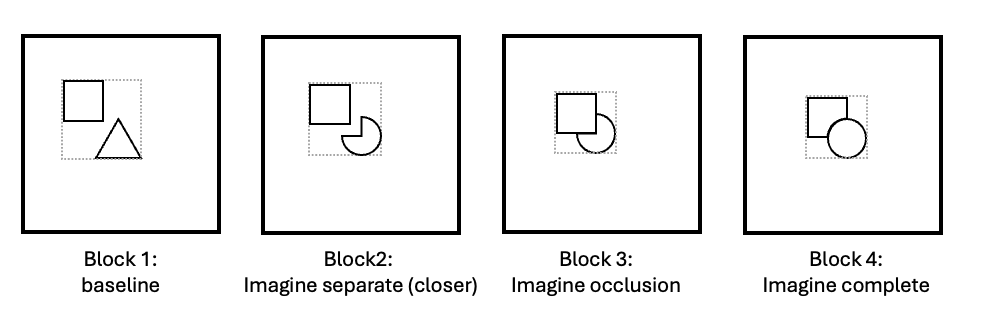

## Documentation
Must be run from within the repo's branch folder.  

```{r setup, echo=FALSE}
library(tidyverse)  
library(knitr)
library(ggplot2)
library(ggridges)
library(ggrain)
library(rstatix)
library(lmerTest)
library(dplyr)
library(ggsignif)
library(purrr)
library(tidyr)
library(broom)
library(emmeans)
library(car)
knitr::opts_chunk$set(echo = TRUE)
```
## v10_within_sub
This experiment tests the visual occlusion effect in mental imagery by using a priming paradigm following Sekuler and Palmer (1992).
If subjects are primed by a circle, and then do a same/ different task. they are faster to determine two circles are the same rather than two Pac-Men are the same. If the prime is a Pac-Man, they are faster in the two Pac-Men test. When we see a shape like “Pac-Man” and a square fits perfectly into the missing quarter, our brain fills in the missing part. This makes us perceive the square as if it is overlaid on a complete circle rather than next to a Pac-Man so that it can prime the two circles discrimination task instead of the two Pac-Men condition.
We predict this is the same in mental imagery: an imagined partially occluded notched shape is presented as complete.
V10 is a within-subject experiment. We ask subjects to imagine the shapes exactly as they appear on the screen. There are four different trial conditions: no-prime, separate, occluded, and complete.
Besides, we added a bounding box to reduce spatial uncertainty. We randomized all the conditions across the study.


### Experiment
https://xh.subjectivityresearch.org/visual_occlusion/v10_within_sub/index.html

### Stimuli and Task Design
```{r}

```

In this task, each trial begins with a fixation cross appearing in the center of the screen for 250 ms, followed by a 250 ms blank screen. Next, a prime display is shown on the screen and disappears after 1000 ms, leaving an empty screen. Subjects need to imagine the stimilus exactly as they appear on the screen. Then a test display appears, containing three shapes: an irrelevant shape that mimics the occluder and is positioned further from the center, and a test pair of two shapes in the middle of the screen. The task requires subjects to determine if the test pair shapes are the same or different (key 'S' for 'same' and key 'D' for 'different'). The same condition includes either two identical shapes (e.g., two circles or two Pac-Men for Pac-Man primes, or two squares or two notched squares for notched square primes), while the different condition includes a pair of different shapes (e.g., a circle and a square or a Pac-Man and a square for Pac-Man primes, or a square and a circle or a notched square and a circle for notched square primes). Feedback is provided based on the response time (RT): if the RT exceeds 1500 ms, a warning message "TOO SLOW! Press the spacebar to continue." appears, and if the RT is faster than 200 ms, a message "Do not press before the test shapes appear. Press the spacebar to continue." is displayed. Finally they need to click the button with their mouse to rate the vividness of their mental imagery. 1 = Not vivid at all, 2 = Slightly vivid, 3 = Moderately vivid, 4 = Very vivid, 5 = Extremely vivid. The next trial begins automatically after a 1000 ms delay. 

The stimuli box measures 400 pixels, with shapes having a diameter of 67 pixels. In the test display, the irrelevant shape is positioned 58 pixels from the left and 58 pixels from the top, with the test pair shapes spaced 89 pixels apart.


### Parameters
- const itiDuration = 1000; //ms  
- const fixationDuration = 250; //ms  
- const imageDuration = 1000; //ms  
- const imageryDuration = 2000; //ms  
- const gap3Duration = 100; //ms a gap after the imagination stage as a reminder of the upcoming task
- const maxResponseTime = 1500; //ms  
- const afterFixationInterval = 250; //ms  

### Subjects
- Platform: Prolific  
- 7 Nov 2024, 16:37
- 50 subjects  
- Age: 18–65  
- Current Country of Residence: United Kingdom, United States  
- Normal vision, no Colorblindness, and no mild cognitive impairment/Dementia  
- Approval Rate: 99–100  
- Number of previous submissions: 50–10000  
- ~29 minutes (with instructions and questionnaires)  
- Total study cost: $333.33 
- Study code: C19E4WDH 

### Key Columns for Analysis
- Subject: exclude participants with low accuracy (46 left) and outliers (45 left).   
- trialNum: 128 trials per subject.  
- test_shape: complete or notched.  
- prime_shape: circle or square.  
- correct_answer: same or different (only analyze "same").  
- correct: 0 means incorrect (either slow or press the wrong key); 1 means correct (only analyze "correct").  
- rt: calculate the mean rt of each condition.  
- trial_condition: 1 = no prime; 2 = separate; 3 = occluded; 4 = complete.  

### Labels
```{r}
# Define the experiment labels for the legend
labels <- c(
  "1" = "No-prime",
  "2" = "Separate",
  "3" = "Occluded",
  "4" = "Complete"
)
```

## Data preparation 
### Load the data file
```{r}
df_input_all <-
  read_csv("v10_within_sub_all_subjects_data.csv")

df_input_all$trial_condition <- as.factor(df_input_all$trial_condition)
```

### Exclude subjects with low accuracy and outliers
```{r}
# Exclude participants with low accuracy
filtered_subject <- df_input_all %>%
  group_by(subject) %>%
  filter(
    sum(correct == 1 & rt > 200) / n() >= 0.8  
  ) %>%
  ungroup()

# Only analyze trials with a correct same response
filtered_data <- filtered_subject %>%
  filter(
    correct == 1,
    correct_answer == "same",
    rt > 200
  )

diff_data <- filtered_data %>%
  group_by(subject, trial_condition, prime_shape, test_shape) %>%
  summarise(mean_rt = mean(rt, na.rm = TRUE), .groups = 'drop') %>%
  spread(test_shape, mean_rt) %>%
  mutate(diff = notched - complete) %>%
  select(subject, prime_shape, diff, trial_condition)
```

### Data preparation for RT analysis
```{r}
# Calculate subjects' average rt and rating for each condition
subject_condition_data_rt <- aggregate(rt ~ subject + trial_condition + test_shape, data = filtered_data, mean)

# Calculate the mean and standard error for rt
mean_data_rt <- aggregate(rt ~ trial_condition + test_shape, data = subject_condition_data_rt, mean)
se_data_rt <- aggregate(rt ~ trial_condition + test_shape, data = subject_condition_data_rt, function(x) sd(x) / sqrt(length(x)))

# Merge the results
plot_data_rt <- merge(mean_data_rt, se_data_rt, by = c("trial_condition", "test_shape"))
colnames(plot_data_rt) <- c("trial_condition", "test_shape", "mean_rt", "se_rt")

# Calculate the Z-score for the 95% confidence interval
z_0.025 <- qnorm(0.975)

# Calculate 95% CI
plot_data_rt$ci_lower <- plot_data_rt$mean_rt - z_0.025 * plot_data_rt$se_rt
plot_data_rt$ci_upper <- plot_data_rt$mean_rt + z_0.025 * plot_data_rt$se_rt
```

### Results summary
```{r}
print(plot_data_rt)
```

## Test for the difference between complete vs notched across four conditions
### Data preparation for RT analysis
```{r}
# Calculate subjects' average diff and rating for each condition
subject_condition_data_diff <- aggregate(diff ~ subject + trial_condition, data = diff_data, mean)

# Calculate the mean and standard error for diff
mean_diff <- aggregate(diff ~ trial_condition, data = subject_condition_data_diff, mean)
se_diff <- aggregate(diff ~ trial_condition, data = subject_condition_data_diff, function(x) sd(x) / sqrt(length(x)))

# Merge the results
plot_data_diff <- merge(mean_diff, se_diff, by = c("trial_condition"))
colnames(plot_data_diff) <- c("trial_condition", "mean_diff", "se_diff")

# Calculate the Z-score for the 95% confidence interval
z_0.025 <- qnorm(0.975)

# Calculate 95% CI
plot_data_diff$ci_lower <- plot_data_diff$mean_diff - z_0.025 * plot_data_diff$se_diff
plot_data_diff$ci_upper <- plot_data_diff$mean_diff + z_0.025 * plot_data_diff$se_diff
```

### T test for the difference within each trial condition
```{r}
diff_data <- subject_condition_data_rt %>%
  group_by(subject, trial_condition, test_shape) %>%
  summarise(mean_rt = mean(rt, na.rm = TRUE), .groups = 'drop') %>%
  spread(test_shape, mean_rt) %>%
  mutate(diff = notched - complete) %>%
  select(subject, trial_condition, diff)

# Spread the differences to wide format
diff_wide <- diff_data %>%
  spread(trial_condition, diff)

# no-prime and complete
t_test_diff_1_4 <- t.test(diff_wide$'1', diff_wide$'4', paired = TRUE)
print(t_test_diff_1_4)

# separate and complete
t_test_diff_2_4 <- t.test(diff_wide$'2', diff_wide$'4', paired = TRUE)
print(t_test_diff_2_4)

# occlude and separate
t_test_diff_2_3 <- t.test(diff_wide$'2', diff_wide$'3', paired = TRUE)
print(t_test_diff_2_3)

# occlude and complete
t_test_diff_3_4 <- t.test(diff_wide$'3', diff_wide$'4', paired = TRUE)
print(t_test_diff_3_4)
```

### Results summary
```{r}
print(plot_data_diff)
```

### Bar plot
```{r}
ggplot(plot_data_diff, aes(x = trial_condition, y = mean_diff, fill = trial_condition)) +
  geom_bar(stat = "identity",
           position = "dodge",
           width = 0.7) +
  geom_errorbar(
    aes(ymin = mean_diff - se_diff, ymax = mean_diff + se_diff),
    position = position_dodge(width = 0.7),
    width = 0.2
  ) +
  labs(y = "Notched - Complete (ms)",
       x = "Trial Condition",
       fill = "Trial Condition"
  ) + 
  coord_cartesian(ylim = c(10, 80)) +
  scale_x_discrete(labels = labels) + 
  theme_classic() + 
  theme_classic() +
  theme(
    legend.position = "none", 
    axis.title = element_text(face = "bold", size = 12),
    plot.title = element_text(face = "bold", hjust = 0.5),
    axis.text = element_text(size = 12)
  )
```


## Data analysis
### Linear model: compare models
```{r}
M1 <- lmer(rt ~ test_shape * trial_condition + (1 + test_shape + trial_condition | subject), REML = F, data = filtered_data)
M2 <- lmer(rt ~ test_shape + trial_condition + (1 + test_shape + trial_condition | subject), REML = F, data = filtered_data)
M3 <- lmer(rt ~ test_shape * trial_condition + (1 + trial_condition | subject), REML = F, data = filtered_data)

##failed to converge
M4 <- lmer(rt ~ test_shape + trial_condition + (1 + trial_condition | subject), REML = F, data = filtered_data)
M5 <- lmer(rt ~ test_shape * trial_condition + (1 + test_shape | subject), REML = F, data = filtered_data)
anova(M4, M5)
#M5 is a better model

M6 <- lmer(rt ~ test_shape * trial_condition + (1 | subject), REML = F, data = filtered_data)
anova(M5, M6)
## AIC favors M5 while BIC favors M6
```

### Linear model results
```{r}
# Filter out trial_condition
filtered_data_analysis <- filtered_data %>% 
  filter(trial_condition %in% c(2, 3))
M5 <- lmer(rt ~ test_shape * trial_condition + (1 + test_shape | subject), REML = TRUE, data = filtered_data_analysis)
summary(M5)
```
## Plots
### line plot divided by prime shape
```{r}
ggplot(
  plot_data_rt,
  aes(
    x = test_shape,
    y = mean_rt,
    group = trial_condition,
    color = trial_condition
  )
) +
  geom_line() +
  geom_point() +
  geom_errorbar(aes(ymin = mean_rt - se_rt, ymax = mean_rt + se_rt), width = 0.05) +
  labs(x = "Test Shape", y = "Mean RT", color = "Trial Condition") +
  coord_cartesian(ylim = c(625, 750)) +
  scale_color_manual(values = scales::hue_pal()(length(labels)), labels = labels) +
  theme_classic() +
  theme(
    legend.title = element_text(face = "bold"),
    axis.title = element_text(face = "bold", size = 12),
    plot.title = element_text(face = "bold", hjust = 0.5),
    axis.text = element_text(size = 12)
  )
```

### Scatter plot with geom_path
```{r}
# the difference: above zero
ggplot(subject_condition_data_rt,
       aes(
         x = as.factor(interaction(test_shape, prime_shape)),
         y = rt,
         color = test_shape
       )) +
  geom_jitter(position = position_jitter(width = 0.3, seed = 3922)) +
  geom_path(
    aes(group = interaction(prime_shape, subject)),
    linewidth = 0.2,
    color = "gray",
    position = position_jitter(width = 0.3, seed = 3922)
  ) +
  labs(x = "Prime Shape",
       y = "Mean Reaction Time (ms)",
       color = "Test Shape"
  ) + 
  scale_y_continuous(
    breaks = seq(300, 1300, by = 200),
    limits = c(300, 1300)
  ) +
  facet_wrap(~prime_shape, scales = "free_x", strip.position = "bottom") +  # Use switch argument
  theme_classic() +
  theme(
    legend.title = element_text(face = "bold"),
    axis.title = element_text(face = "bold", size = 12),
    plot.title = element_text(face = "bold", hjust = 0.5),
    axis.text = element_text(size = 12),
    axis.ticks.x = element_blank(),
    axis.text.x = element_blank(),
    strip.placement = "outside",
    strip.text = element_text(size = 12),  # Adjust strip text properties
    strip.background = element_blank(),
  )
```


### Scatter plot of the difference
```{r}
ggplot(diff_data, aes(x = prime_shape, y = diff)) +
  geom_jitter(position = position_jitter(width = 0.2, seed = 3922), color = "blue") +
  geom_hline(yintercept = 0, linetype = "dashed", color = "red") +
  labs(x = "Prime Shape",
       y = "Notched - Complete") +
  theme_classic() +
  theme(
    legend.title = element_text(face = "bold"),
    axis.title = element_text(face = "bold", size = 12),
    plot.title = element_text(face = "bold", hjust = 0.5),
    axis.text = element_text(size = 12)
  )
```

### Raincloud plot
```{r}
ggplot(subject_condition_data_rt, aes(x = factor(prime_shape), y = rt, fill = test_shape, color = test_shape)) +
   geom_rain(alpha = 0.5, 
            boxplot.args = list(color = "black", outlier.shape = NA), 
            boxplot.args.pos = list(
              width = 0.12, position = ggpp::position_dodgenudge(x = 0.15)),
            violin.args.pos = list(
              side = "r",
              width = 0.7, position = position_nudge(x = 0.25))) +
  labs(x = "Prime Shape",
       y = "Mean Reaction Time (ms)",
       color = "Test Shape",
       fill = "Test Shape"
  ) + 
  scale_y_continuous(
    breaks = seq(300, 1300, by = 200),
    limits = c(300, 1300)  # Set the y-axis limits
  ) +
  theme_classic() +
  theme(
    legend.title = element_text(face = "bold"),
    axis.title = element_text(face = "bold", size = 12),
    plot.title = element_text(face = "bold", hjust = 0.5),
    axis.text = element_text(size = 12)
  )
```


## Results of RT analysis
The reaction time for notched shape is significantly longer than the complete, regardless of the prime shape.
## Vividness Rating and Imagination Time
### Quality check
```{r}
quality_check <- filtered_subject %>%
  group_by(subject) %>%
  summarise(
    distinct_rating = n_distinct(rating),
    sd_rating = sd(rating, na.rm = TRUE),
    max_rating = max(rating, na.rm = TRUE),
    min_rating = min(rating, na.rm = TRUE),
    mean_rating = mean(rating, na.rm = TRUE),
    median_rating = median(rating, na.rm = TRUE),
    .groups = 'drop'
  )

# Create a separate data frame for the max, min, mean, and median
stat_summary <- quality_check %>%
  pivot_longer(cols = c(max_rating, min_rating, mean_rating, median_rating), 
               names_to = "statistic", values_to = "value")

# Bar plot for the range of ratings with dots
ggplot(quality_check, aes(x = factor(subject), y = distinct_rating)) +
  geom_bar(stat = "identity", fill = "gray") +
  geom_point(data = stat_summary, aes(x = factor(subject), y = value, color = statistic), 
             position = position_dodge(width = 0), size = 2, alpha = 0.6) +
  scale_color_manual(values = c("max_rating" = "red", "min_rating" = "blue", "mean_rating" = "green", "median_rating" = "purple"),
                     labels = c("max_rating" = "Max", "min_rating" = "Min", "mean_rating" = "Mean", "median_rating" = "Median")) +
  scale_y_continuous(expand = expansion(mult = c(0, 0.05))) +  # Add space at the bottom and top of y-axis
  scale_x_discrete(expand = expansion(mult = c(0.02, 0.02))) +  # Add space between bars and left side of plot
  labs(x = "Subject", y = "Ratings", color = "Statistics") +
  theme_classic() +
  theme(
    axis.title = element_text(face = "bold", size = 12),
    axis.text = element_text(size = 8)
  )
```

### Rating frequency
```{r}
# Calculate counts of each rating for circle and square
rating_counts <- filtered_subject %>%
  group_by(prime_shape, rating) %>%
  summarise(count = n(), .groups = 'drop') %>%
  mutate(prime_shape = factor(prime_shape, levels = c("square", "circle")))
rating_counts$rating <- factor(rating_counts$rating, levels = 1:5)

# Plotting the frequency of ratings for circle and square side by side
ggplot(rating_counts, aes(x = rating, y = count, fill = prime_shape)) +
  geom_bar(stat = "identity", position = position_dodge(width = 0.9)) +  # Adjust width to avoid overlap
  labs(x = "Rating", y = "Frequency", fill = "Prime Shape") +
  scale_y_continuous(expand = c(0, 0)) +  # Ensure bars start from the x-axis with no gap
  coord_cartesian(ylim = c(0, 300)) +  # Set y-axis limits
  theme_classic() +  # Clean theme with no grid
  theme(
    legend.title = element_text(face = "bold"),
    axis.title = element_text(face = "bold", size = 12),
    plot.title = element_text(face = "bold", hjust = 0.5),
    axis.text = element_text(size = 12),
  )
```

### Rating difference between circle and square
```{r}
average_ratings <- filtered_subject %>%
  filter(prime_shape %in% c("square", "circle")) %>%
  group_by(subject, prime_shape) %>%
  summarise(mean_rating = mean(rating, na.rm = TRUE), .groups = 'drop') %>%
  spread(prime_shape, mean_rating)

# Perform Wilcoxon Signed-Rank Test (in place of the paired t-test)
wilcox_result <- wilcox.test(average_ratings$circle, average_ratings$square, paired = TRUE, exact = FALSE)
print(wilcox_result)
```


### Ratings and RT (circle and square separately)
```{r}
# For Square
ggplot(data = filtered_data %>% filter(prime_shape == "square"), aes(x = rating, y = rt, color = test_shape)) +
  geom_jitter(position = position_jitterdodge(jitter.width = 0.3, dodge.width = 0.5, seed = 3922), size = 1.5, alpha = 0.6) +  # Adjust alpha for transparency
  geom_smooth(method = "lm", formula = y ~ x, se = FALSE, aes(linetype = test_shape), show.legend = FALSE) +  # Add regression lines
  labs(x = "Rating (Square)",
       y = "RT (Square)",
       color = "Test Shape") +
  scale_y_continuous(
    breaks = seq(200, 1600, by = 400),
    limits = c(200, 1600)
  ) +
  theme_classic() +
  theme(
    legend.title = element_text(face = "bold"),
    axis.title = element_text(face = "bold", size = 12),
    plot.title = element_text(face = "bold", hjust = 0.5),
    axis.text = element_text(size = 12)
  )

# For Circle
ggplot(data = filtered_data %>% filter(prime_shape == "circle"), aes(x = rating, y = rt, color = test_shape)) +
  geom_jitter(position = position_jitterdodge(jitter.width = 0.3, dodge.width = 0.5, seed = 3922), size = 1.5, alpha = 0.6) +  # Adjust alpha for transparency
  geom_smooth(method = "lm", formula = y ~ x, se = FALSE, aes(linetype = test_shape), show.legend = FALSE) +  # Add regression lines
  labs(x = "Rating (Circle)",
       y = "RT (Circle)",
       color = "Test Shape") +
  scale_y_continuous(
    breaks = seq(200, 1600, by = 400),
    limits = c(200, 1600)
  ) +
  theme_classic() +
  theme(
    legend.title = element_text(face = "bold"),
    axis.title = element_text(face = "bold", size = 12),
    plot.title = element_text(face = "bold", hjust = 0.5),
    axis.text = element_text(size = 12)
  )
```


### Ratings and RT (circle/square, and complete/notched separately)
```{r}
# Plot with different colors and shapes for each condition and adjust position
ggplot(filtered_data, aes(x = rating, y = rt, color = interaction(prime_shape, test_shape), shape = interaction(prime_shape, test_shape))) +
  geom_jitter(position = position_jitterdodge(jitter.width = 0.45, dodge.width = 0.6, seed = 3922), size = 1.5, alpha = 0.5) +  # Adjust alpha for transparency
  geom_smooth(method = "lm", formula = y ~ x, se = FALSE, aes(linetype = interaction(prime_shape, test_shape)), show.legend = FALSE) +  # Add regression lines
  labs(x = "Rating",
       y = "RT",
       color = "Condition",
       shape = "Condition") +
  scale_color_manual(values = c("circle.complete" = "blue", "circle.notched" = "green", "square.complete" = "red", "square.notched" = "purple")) +
  scale_shape_manual(values = c("circle.complete" = 16, "circle.notched" = 1, "square.complete" = 15, "square.notched" = 0)) +  # Assign different shapes
  scale_linetype_manual(values = c("circle.complete" = "solid", "circle.notched" = "dashed", "square.complete" = "solid", "square.notched" = "dashed")) +  # Set linetypes
  scale_y_continuous(
    breaks = seq(200, 1600, by = 400),
    limits = c(200, 1600)
  ) +
  theme_classic() +
  theme(
    legend.title = element_text(face = "bold"),
    axis.title = element_text(face = "bold", size = 12),
    plot.title = element_text(face = "bold", hjust = 0.5),
    axis.text = element_text(size = 12)
  )
```

### Ratings and RT (complete and notched separately)
```{r}
# Collapse across prime_shape, differentiate by test_shape
ggplot(filtered_data, aes(x = rating, y = rt, color = test_shape, shape = test_shape)) +
  geom_jitter(position = position_jitterdodge(jitter.width = 0.3, dodge.width = 0.5, seed = 3922), size = 1.5, alpha = 0.6) +  # Adjust alpha for transparency
  geom_smooth(method = "lm", formula = y ~ x, se = FALSE, aes(linetype = test_shape), show.legend = FALSE) +  # Add regression lines
  labs(x = "Rating",
       y = "RT",
       color = "Test Shape",
       shape = "Test Shape") +
  scale_shape_manual(values = c("complete" = 16, "notched" = 1)) +  # Assign different shapes
  scale_linetype_manual(values = c("complete" = "solid", "notched" = "dashed")) +  # Set linetypes
  scale_y_continuous(
    breaks = seq(200, 1600, by = 400),
    limits = c(200, 1600)
  ) +
  theme_classic() +
  theme(
    legend.title = element_text(face = "bold"),
    axis.title = element_text(face = "bold", size = 12),
    plot.title = element_text(face = "bold", hjust = 0.5),
    axis.text = element_text(size = 12)
  )
```
### Spearman correlation
```{r}
# Spearman correlation for complete test_shape
spearman_complete <- cor.test(filtered_data$rating[filtered_data$test_shape == "complete"],
                              filtered_data$rt[filtered_data$test_shape == "complete"],
                              method = "spearman", exact = FALSE)

# Spearman correlation for notched test_shape
spearman_notched <- cor.test(filtered_data$rating[filtered_data$test_shape == "notched"],
                             filtered_data$rt[filtered_data$test_shape == "notched"],
                             method = "spearman", exact = FALSE)

print(spearman_complete)
print(spearman_notched)
```
### Linear model: compare models
```{r}
# here the rating is converted to different categories rather than continuous numbers
filtered_data$rating <- as.factor(filtered_data$rating)

M6 <- lmer(rt ~ test_shape * rating + (1 + test_shape + rating | subject), REML = F, data = filtered_data)
M7 <- lmer(rt ~ test_shape + rating + (1 + test_shape + rating | subject), REML = F, data = filtered_data)
anova(M6, M7)
## M7 (without interaction) is a better model
## Warning message: boundary (singular) fit: see help('isSingular')
## There may be an unnecessary random effect

M8 <- lmer(rt ~ test_shape + rating + (1 + rating | subject), REML = F, data = filtered_data)
M9 <- lmer(rt ~ test_shape + rating + (1 + test_shape | subject), REML = F, data = filtered_data)
anova(M8, M9)
## M9 is a better model

M10 <- lmer(rt ~ test_shape + rating + (1 | subject), REML = F, data = filtered_data)
anova(M9, M10)
## AIC favors M9 while BIC favors M10
```

### Linear model results
```{r}
## AIC favors M9
summary(M9)
emmeans_M9 <- emmeans(M9, pairwise ~ test_shape | rating)
summary_emmeans_M9 <- summary(emmeans_M9$contrasts)
summary_emmeans_M9

## BIC favors M10
summary(M10)
emmeans_M10 <- emmeans(M10, pairwise ~ test_shape | rating)
summary_emmeans_M10 <- summary(emmeans_M10$contrasts)
summary_emmeans_M10
```


